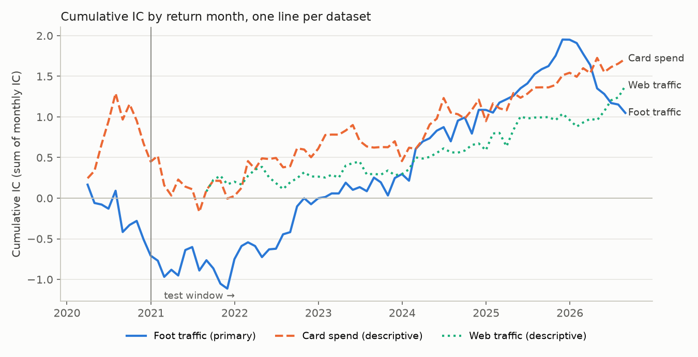
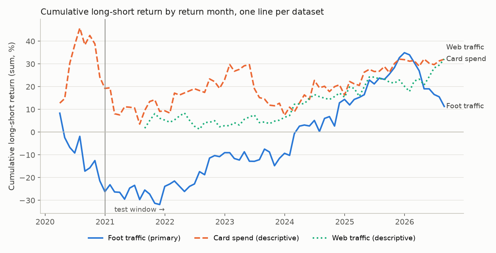

# Carbon Arc alt data vs next-month returns: results

Run 2026-10-28. Rule fixed in advance in [RULE.md](RULE.md) (21:20); computed after, by
`step0_survivorship.py` and `run_test.py`. Aggregates and statistics only; no raw Carbon Arc value
appears in any file here.

## Summary (for a mentor)

We tested whether year-over-year growth in three Carbon Arc datasets (store visits, card spending,
web visits) ranks stocks within their sector by next-month return, using one rule written down
before looking. From 2021 to August 2026 all three point the right way but weakly: foot traffic,
our main test, is not statistically significant (IC t 1.45, long-short t 1.24), and it lost money
both in 2026 and in its 10 COVID-era design months. Web traffic looks best (IC t 2.5), but it was
labelled descriptive in advance because it has no design period, and its coverage is mapped from
today's companies, so none of this is strong enough to add to the model.

## Step 0: survivorship of the permno mapping

**What was compared.** A permno is "mapped" if it has any Carbon Arc row. The comparison groups
are panel stocks in the same 2-digit GICS sectors as the mapped names (sectors with at least 3
mapped names) that were present during the dataset's months, split by whether they are still listed
in Aug 2026.

| | Foot traffic | Card spend | Web traffic |
|---|---:|---:|---:|
| Data months | 2019-01 to 2026-08 | 2019-01 to 2026-08 | 2020-06 to 2026-08 |
| Mapped permnos | 102 | 119 | 316 |
| … still in panel Aug 2026 | 84 | 96 | 287 |
| … **left panel before 2025** | **12** | **13** | **14** |
| … left panel 2025 to Jul 2026 | 6 | 10 | 15 |
| Exits of mapped permnos, by year | 2020:1, 2023:5, 2024:6, 2025:4, 2026:2 | 2020:1, 2023:6, 2024:6, 2025:6, 2026:4 | 2020:2, 2022:1, 2023:8, 2024:3, 2025:9, 2026:6 |
| Carbon Arc rows after the permno's last panel month | 392 of 9,198 | 455 of 10,351 | 506 of 23,127 |
| Carbon Arc rows on months with no panel row | 809 | 1,103 | 1,540 |
| Comparison sectors | 25, 30 | 25, 30 | 20, 25, 30, 35, 40, 45, 50, 60 |
| **Small or larger: % covered, still listed** (n) | 19.5% (431) | 22.3% (431) | 13.2% (2,164) |
| **Small or larger: % covered, exited earlier** (n) | 14.9% (121) | 19.0% (121) | 3.9% (699) |
| **Large or mega: % covered, still listed** (n) | 19.8% (268) | 23.5% (268) | 19.5% (1,261) |
| **Large or mega: % covered, exited earlier** (n) | 8.6% (35) | 14.3% (35) | 6.5% (261) |

**Reading.**
- **Foot traffic and card spend.** Delisted firms are under-covered but present:
  - For small-or-larger stocks, the exited firms' coverage is about three-quarters of the
    survivors' (foot traffic 14.9% vs 19.5%) or more (card spend 19.0% vs 22.3%).
  - For large or mega caps the gap is wider: 8.6% vs 19.8% for foot traffic and 14.3% vs 23.5% for
    card spend. Those exited groups are only 35 firms each.
  - This is much milder than the round-1 8-K data (13% vs 93%), but it is the same direction.
- **Web traffic is the most tilted.** It covers 3.9% of exited firms against 13.2% of survivors,
  partly because its 313 names were picked from our own recent book.
- **Rows after exit.** About 4–5% of Carbon Arc rows fall after the mapped permno's last panel
  month. For those firms the vendor series continues past the delisting, which fits a mapping built
  from today's ticker list. The rule's "live stock-month" filter drops these rows.

## Main table

A row's window is set by the month the return is earned (signal month + 1).
- **IC:** monthly Spearman correlation between the sector z-scored signal and the next-month excess
  return. Its t-stat is Newey-West with 3 lags.
- **L-S:** top third minus bottom third within each sector, equal-weighted, averaged across sectors
  weighted by name count. Returns are gross.

| Dataset | Status | Window | Months | Return months | Avg names / month | Sectors | Mean IC | IC t (NW3) | Hit rate | L-S mean %/mo | L-S Sharpe (ann.) | L-S t |
|---|---|---|---:|---|---:|---:|---:|---:|---:|---:|---:|---:|
| Foot traffic | **primary** | design | 10 | 2020-03 to 2020-12 | 66 | 2 | −0.071 | −2.24 | 40% | −2.61 | −1.17 | −1.06 |
| Foot traffic | **primary** | **test** | **68** | 2021-01 to 2026-08 | 68 | 2 | **+0.026** | **+1.45** | 57% | **+0.55** | **+0.52** | **+1.24** |
| Card spend | descriptive | design | 10 | 2020-03 to 2020-12 | 68 | 2 | +0.045 | +0.43 | 60% | +1.92 | +0.70 | +0.64 |
| Card spend | descriptive | test | 68 | 2021-01 to 2026-08 | 75 | 2 | +0.019 | +1.56 | 56% | +0.19 | +0.18 | +0.42 |
| Web traffic | descriptive | design | 0 | none | – | – | – | – | – | – | – | – |
| Web traffic | descriptive | test | 61 | 2021-08 to 2026-08 | 253 | 7 | +0.023 | +2.54 | 64% | +0.53 | +0.85 | +1.93 |

The month counts match the rule's expectation:
- **Foot traffic and card spend:** 10 design months, all during COVID, and 68 test months.
- **Web traffic:** no design window; the test starts at 2021-08, its first year-over-year month.

## Per year, test window (by return year)

| Dataset | Year | Months | Avg names | Mean IC | Hit rate | L-S mean %/mo | L-S t |
|---|---:|---:|---:|---:|---:|---:|---:|
| Foot traffic | 2021 | 12 | 75 | −0.004 | 42% | +0.19 | +0.16 |
| Foot traffic | 2022 | 12 | 76 | +0.062 | 75% | +1.23 | +1.50 |
| Foot traffic | 2023 | 12 | 75 | +0.025 | 58% | −0.02 | −0.02 |
| Foot traffic | 2024 | 12 | 67 | +0.066 | 67% | +1.97 | +1.45 |
| Foot traffic | 2025 | 12 | 59 | +0.072 | 83% | +1.71 | +2.39 |
| Foot traffic | 2026 | 8 | 52 | −0.113 | 0% | −2.95 | −3.34 |
| Card spend | 2021 | 12 | 80 | −0.035 | 42% | −0.82 | −0.58 |
| Card spend | 2022 | 12 | 82 | +0.048 | 58% | +1.14 | +1.17 |
| Card spend | 2023 | 12 | 84 | −0.013 | 50% | −1.31 | −1.07 |
| Card spend | 2024 | 12 | 76 | +0.041 | 58% | +0.74 | +0.68 |
| Card spend | 2025 | 12 | 67 | +0.050 | 67% | +1.30 | +1.63 |
| Card spend | 2026 | 8 | 58 | +0.021 | 62% | +0.02 | +0.04 |
| Web traffic | 2021 | 5 | 227 | +0.040 | 80% | +1.06 | +0.99 |
| Web traffic | 2022 | 12 | 249 | +0.005 | 50% | −0.20 | −0.36 |
| Web traffic | 2023 | 12 | 262 | +0.003 | 58% | +0.31 | +0.71 |
| Web traffic | 2024 | 12 | 257 | +0.024 | 67% | +0.74 | +1.41 |
| Web traffic | 2025 | 12 | 258 | +0.031 | 67% | +0.40 | +0.52 |
| Web traffic | 2026 | 8 | 248 | +0.052 | 75% | +1.49 | +1.55 |

Foot traffic reversed sharply in 2026: all 8 months had a negative IC, and long-short lost
−2.95%/month. Over the same months its universe shrank to about 52 names.

## Is it new information? Correlations

These are average monthly cross-sectional Spearman correlations between sector z-scores, over
months with at least 20 shared names.
- **Momentum** = `ret_12_1`, z-scored within sector on the same universe as the signal.
- **Test window:** return months 2021-01 to 2026-08.

| Pair | Test: avg corr | Test: months | All months: avg corr | All: months | Avg shared names |
|---|---:|---:|---:|---:|---:|
| Foot traffic vs momentum | +0.074 | 68 | +0.098 | 78 | 68 |
| Card spend vs momentum | +0.200 | 68 | +0.226 | 78 | 75 |
| Web traffic vs momentum | +0.057 | 61 | +0.057 | 61 | 253 |
| Foot traffic vs card spend | +0.257 | 68 | +0.251 | 78 | 63 |
| Foot traffic vs web traffic | n/a | 0 | n/a | 0 | 0 |
| Card spend vs web traffic | n/a | 0 | n/a | 0 | 0 |

- **Foot traffic and web traffic are nearly unrelated to momentum** (correlations of 0.06–0.10), so
  what little they carry is not just past returns.
- **Card spend overlaps momentum more** (+0.20), and it overlaps foot traffic (+0.26).
- **Web traffic shares no names with the other two.** Its names were chosen outside the consumer
  universe.

## Charts

- [cum_ic.png](cum_ic.png): cumulative IC (running sum of monthly IC) by return month, one line per
  dataset. A vertical line marks the start of the test window.
- [cum_long_short.png](cum_long_short.png): cumulative long-short return (running sum of monthly %),
  same layout.

Monthly IC, long-short, name and sector counts for all three datasets are in `monthly_stats.csv`.

## Caveats

- **Today's data vintage, not point-in-time.**
  - Every value was pulled on 2026-10-28.
  - The card spend panel is restated monthly by the vendor.
  - Foot traffic and web traffic are modelled and reweighted series, with no vintages.
  - What a 2022 investor would have seen may differ. The one-month safety lag addresses
    publication delay, not revisions.
- **Possible survivorship bias in the permno mapping** (Step 0).
  - Firms that later delisted are under-covered: for large or mega caps, 8.6% vs 19.8% for foot
    traffic and 14.3% vs 23.5% for card spend; web traffic covers 3.9% vs 13.2% of small-or-larger
    stocks.
  - Tickers were matched by today's label, and AAN, CZR, COHR, INST and S each map to two
    companies.
  - The live-month filter removes rows outside a permno's panel life, but it can't add back firms
    the vendor never listed.
- **Small, concentrated universes.**
  - Foot traffic covers about 100 consumer names, around 68 a month after filters, in 2 sectors.
  - Card spend covers about 117, around 75 a month, in 2 sectors.
  - Web traffic covers about 313, mostly non-consumer, around 253 a month, in 7 sectors.
  - With 2 sectors, the foot traffic and card spend long-short is close to two small portfolios.
- **Gross returns, no costs.** No trading costs, shorting costs or capacity limits.
- **One rule per dataset, no tuning.** We did not try other signals, lags or groupings. Three
  datasets were tested, so a single t near 2 (web traffic) is roughly what chance alone can
  produce.
- **Short or missing design windows.**
  - Foot traffic and card spend have 10 design months, all during COVID. Foot traffic's were
    negative (IC t −2.24), the opposite of its test sign.
  - Web traffic has none, so its test results were never set up to be a decision test.
